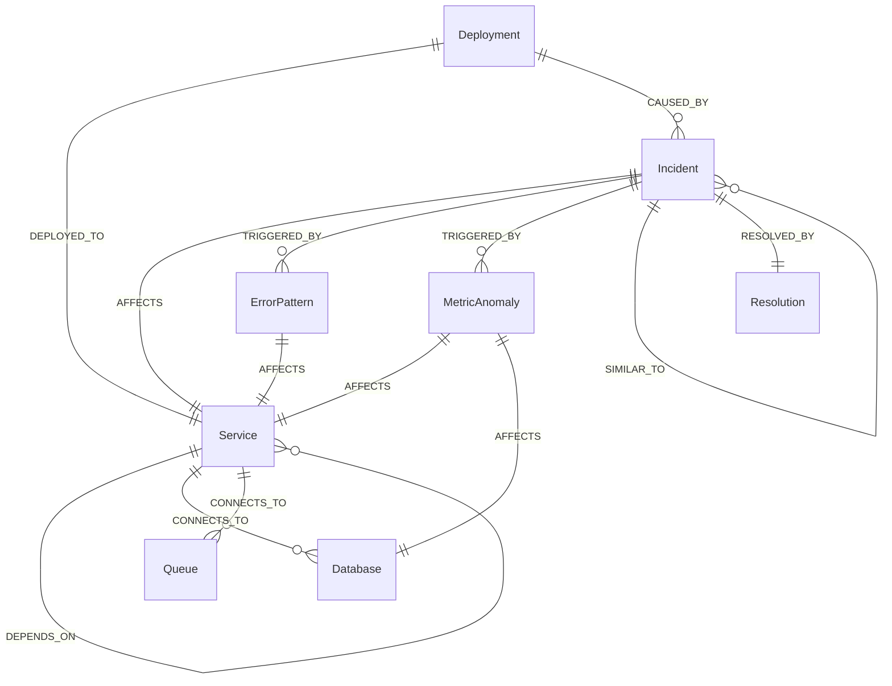

# TRACEFORGE AI ⚡
### AI-Powered Autonomous Incident Investigator with FalkorDB Graph & Episodic Memory

> **Graph Hacks 2026 Submission**<br>
> **Primary Target Track: Track 01 — Agents That Act on Connected Data**<br>
> *Secondary Themes: Agent Memory and Coordination • Company Brain*<br>
> *Official Hackathon Rules: [https://www.wemakedevs.org/hackathons/falkordb/rules](https://www.wemakedevs.org/hackathons/falkordb/rules)*

---

## 1. Product Vision & Problem

When modern distributed microservices suffer cascading outages, on-call engineers are overwhelmed with disconnected alerts, fragmented telemetry, and ambiguous stack traces. Traditional LLM chatbots fail in production incident triage because:

1. **They lack topological relationship awareness** — they cannot trace how a connection-pool leak in a tier-3 auth dependency triggers circuit-breaker trips in an upstream checkout service.
2. **They hallucinate causes without verifiable proof** — they propose hypotheses without concrete graph traversal proofs.
3. **They lack cross-session operational memory** — past postmortems and validated fixes are forgotten, causing repeat downtime.

**TRACEFORGE AI** solves this by positioning **FalkorDB graph relationships** and **episodic incident memory** at the core of an autonomous agent investigation loop. When an incident triggers, TRACEFORGE's agent dynamically calls graph tools to query FalkorDB using native OpenCypher, traverses dependency cascades across services and databases, identifies upstream code deployments, retrieves validated historical resolutions, and synthesizes verifiable findings under a strict **Human-in-the-Loop** safety gate.

---

## 2. Why FalkorDB is Essential (Not Decorative)

In compliance with **Rule 2 and Rule 3** of Graph Hacks 2026, FalkorDB is the primary architectural backbone that materially drives investigation results—not a decorative visualization or cache layer.

| Requirement | Why Relational / Vector Fails | Why FalkorDB is Strictly Required |
| :--- | :--- | :--- |
| **Multi-Hop Failure Cascades** | Relational databases require expensive, fragile recursive CTEs to traverse variable-depth dependencies (`A -> B -> C -> D`). Vectors cannot compute reachability. | FalkorDB executes sub-millisecond variable-length path queries (`MATCH (s:Service)-[*1..4]-(upstream)`) to instantly trace root-cause paths. |
| **Causal Blame Assignment** | Ordinary key-value or document stores cannot link a code deployment commit to a saturated database pool and downstream 5xx errors. | FalkorDB models heterogeneous nodes (`Deployment`, `Service`, `Database`, `ErrorPattern`, `MetricAnomaly`) connected by typed relationships (`DEPLOYED_TO`, `DEPENDS_ON`, `AFFECTS`, `TRIGGERED_BY`). |
| **Episodic Resolution Transfer** | Chatbots hallucinate generic fixes or rely on unstructured vector search that retrieves syntactically similar words without structural relevance. | FalkorDB models incident memory as connected subgraphs (`Incident -[:SIMILAR_TO]-> HistoricalIncident -[:RESOLVED_BY]-> Resolution`), enabling graph-grounded postmortem reuse. |
| **Zero-Hallucination Proofs** | LLMs cannot verify their own claims. | Every Confirmed Fact surfaced by TRACEFORGE is backed by an inspectable OpenCypher query result directly executed against FalkorDB. |

---

## 3. Architecture & Graph Data Model

```
                    ┌────────────────────────────────────────────────────────┐
                    │          TRACEFORGE AI React Frontend (Vite/TS)        │
                    │  Dark Developer SaaS • Interactive Graph Visualizer    │
                    │  Confirmed Facts vs Hypotheses • Cypher Console • HITL │
                    └───────────────────────────┬────────────────────────────┘
                                               │ REST / JSON (Port 8000)
                                                ▼
                    ┌────────────────────────────────────────────────────────┐
                    │               FastAPI High-Performance API             │
                    │  Routers: /api/investigations, /api/graph, /api/memory  │
                    └───────────┬───────────────────────────────┬────────────┘
                                │                               │
       ┌────────────────────────┴──────────────┐   ┌────────────┴──────────────┐
       │     Investigation & Memory Engine     │   │     LLM Provider Gateway  │
       │  • Autonomous ReAct Agent Loop        │   │  • Deterministic Engine   │
       │  • Multi-Hop Graph Traversal          │   │  • OpenAI / Claude        │
       │  • Confirmed Facts vs Hypotheses      │   │  • Gemini / Groq / Ollama │
       │  • Postmortem Resolution Transfer     │   │                           │
       └────────────────────────┬──────────────┘   └───────────────────────────┘
                                │ OpenCypher
                                ▼
                    ┌────────────────────────────────────────────────────────┐
                    │                 FalkorDB Graph Engine                  │
                    │                                                        │
                    │  Nodes (29 Entities):                                  │
                    │   • (:Service)        • (:Database)   • (:Queue)       │
                    │   • (:Deployment)     • (:ErrorPattern)                │
                    │   • (:MetricAnomaly)  • (:Incident)   • (:Resolution)  │
                    │                                                        │
                    │  Relationships (32 Edges):                             │
                    │   • [:DEPENDS_ON]     • [:CONNECTS_TO]                 │
                    │   • [:DEPLOYED_TO]    • [:AFFECTS]                     │
                    │   • [:TRIGGERED_BY]   • [:CAUSED_BY]                   │
                    │   • [:RESOLVED_BY]    • [:SIMILAR_TO]                  │
                    │                                                        │
                    │  Dual Mode:                                            │
                    │   1. Live FalkorDB Server (Local Docker or Cloud)      │
                    │   2. In-Memory OpenCypher Engine (Offline fallback)    │
                    └────────────────────────────────────────────────────────┘
```

### Graph Schema (Mermaid)



---

## 4. OpenCypher Query Catalog

TRACEFORGE AI's autonomous tools and deterministic engine execute real OpenCypher queries against FalkorDB. Below are key queries driving incident triage:

| Action / Tool | OpenCypher Query Pattern | Purpose |
| :--- | :--- | :--- |
| **Incident Context** | `MATCH (i:Incident {id: $id})-[r:AFFECTS]->(s:Service) RETURN i, r, s` | Discovers initial service entrypoint and impact tier. |
| **Dependency Blast Radius** | `MATCH (s:Service)-[r:DEPENDS_ON]->(dep:Service) WHERE s.id = $id RETURN s, r, dep` | Traverses downstream dependencies to identify cascade path. |
| **Infrastructure Links** | `MATCH (s:Service)-[r:CONNECTS_TO]->(d:Database) WHERE s.id = $id RETURN s, r, d` | Discovers underlying datastores and connection pools. |
| **Recent Deployments** | `MATCH (d:Deployment)-[r:DEPLOYED_TO]->(s:Service) WHERE s.id = $id RETURN d, r, s` | Identifies configuration changes deployed prior to outage. |
| **Error & Anomaly Mapping** | `MATCH (e:ErrorPattern)-[r:AFFECTS]->(s:Service) WHERE s.id = $id RETURN e, r, s` | Maps active stack traces and log patterns to affected nodes. |
| **Episodic Memory Recall** | `MATCH (i:Incident)-[r:SIMILAR_TO]->(h:Incident)-[:RESOLVED_BY]->(res:Resolution) RETURN i, h, res` | Retrieves validated historical postmortems and proven fixes. |
| **Full Topology View** | `MATCH (n) RETURN n`<br>`MATCH (a)-[r]->(b) RETURN a.id, type(r), b.id, properties(r)` | Powers the interactive visual graph explorer. |
| **Idempotent Seeder** | `MERGE (n:Service {id: $id}) SET n += $props`<br>`MATCH (a {id: $src}), (b {id: $tgt}) MERGE (a)-[r:TYPE]->(b) SET r += $props` | Seeds 29 nodes and 32 edges with zero duplicate risk. |

---

## 5. Core Features

### A. Graph-Based Incident Investigation
- Select or input an incident (e.g. `INC-2026-1042: Payment & Checkout Cascade Outage`).
- Executes multi-hop OpenCypher queries to traverse dependencies, database links, and recent deployments.
- Clearly separates **Confirmed Facts** (100% verified via graph queries with inspectable Cypher proofs) from **Root-Cause Hypotheses** (ranked by confidence with full causal cascade paths).

### B. Persistent Cross-Session Memory
- Retains past incident postmortems, root causes, and proven fixes inside FalkorDB.
- Computes graph similarity against historical precedents (e.g. `INC-2026-0814: Auth Token Starvation Cascade` with 94% similarity).
- Explains **why** a past incident influenced the current recommendation.
- Allows recording new resolved postmortems into FalkorDB memory directly from the UI.

### C. Interactive Graph Explorer
- Visualizes microservice topologies, data stores, deployments, and error cascades.
- Filter by node types (`Service`, `Incident`, `Database`, `Deployment`, `ErrorPattern`, `MetricAnomaly`, `Resolution`).
- Inspect node properties, connections, and owners via the slide-out inspector drawer.
- Path highlighting: visually isolates the exact causal cascade path on the canvas.

### D. Actionable Remediation (Human-in-the-Loop)
- Generates precise remediation actions (`CONFIG_UPDATE`, `ROLLBACK`, `CIRCUIT_BREAKER`).
- Displays dry-run simulation output and risk levels (`LOW`, `MEDIUM`, `HIGH`).
- **Strict Human Approval Gate**: automated state changes are permanently disabled. An engineer must explicitly inspect the dry run and enter approval credentials before changes take effect.

### E. Autonomous Tool-Calling Agent Loop (Track 1: Connected Data)
- **Dynamic Tool Selection**: An optional autonomous agent mode dynamically reasons over graph observations and selects among `CypherQueryTool`, `DependencyCascadeTool`, and `MemoryRetrievalTool`.
- **Bounded Iteration Loop**: Strict boundary (`MAX_AGENT_ITERATIONS=5`) prevents runaway queries or infinite loops.
- **Input & Tool Validation**: Rejects unsupported tools and malformed arguments safely with recorded `ERROR` audit traces.
- **Full Traceable Execution**: Displays chronological execution latency, rows returned, evidence items derived, and sanitized parameters in the UI trace viewer.
- **Deterministic Pipeline Fallback**: Automatically falls back to the deterministic pipeline if agent mode is disabled or if an external model call encounters an error.
- **Strict Human Approval Gate**: All proposed remediation actions require human approval and are NEVER automatically executed.

### F. Live OpenCypher Query Console
- Test arbitrary OpenCypher queries against the graph database with sub-millisecond execution times.
- Preset template queries for instant graph inspection.
- Full audit log of all Cypher queries executed during automated investigations.

---

## 4. FalkorDB Integration & Rule Compliance

TRACEFORGE AI strictly complies with the Graph Hacks 2026 requirement that **FalkorDB is central and functional**, not decorative:
- Every investigation step generates and evaluates real Cypher queries:
  ```cypher
  MATCH (i:Incident {id: $incident_id})-[r:AFFECTS]->(s:Service) RETURN i, r, s
  MATCH (s:Service)-[r:DEPENDS_ON]->(dep:Service) WHERE s.id = $service_id RETURN s, r, dep
  MATCH (d:Deployment)-[r:DEPLOYED_TO]->(s:Service) RETURN d, r, s
  MATCH (i:Incident)-[r:SIMILAR_TO]->(h:Incident)-[:RESOLVED_BY]->(res:Resolution) RETURN i, h, res
  ```
- **Zero Hardcoded Mock Responses**: Node topologies, edge traversals, and neighbor discoveries are computed dynamically against the graph database.
- **Dual-Engine Architecture**: Connects seamlessly to a live FalkorDB cluster or FalkorDB Cloud instance via the official `falkordb` Python client. When a live FalkorDB server is offline, it automatically falls back to an internal FalkorDB-compatible Property Graph Cypher Engine, ensuring anyone evaluating the project can run it instantly without mandatory external containers.

---

## 5. Quick Start & Setup Guide

### Prerequisites
- Python 3.10+ (Tested on Python 3.14)
- Node.js 18+ (Tested on Node.js 24)
- *(Optional)* Docker (if running local FalkorDB container)

### Step 1: Clone and Set Up Backend
```bash
# Navigate to project directory
cd "TRACEFORGE AI"

# Create and activate Python virtual environment
python -m venv venv
# On Windows:
.\venv\Scripts\activate
# On Linux/macOS:
source venv/bin/activate

# Install pinned dependencies
pip install -r requirements.txt
```

### Step 2: Configure Environment Variables
Copy the example environment file:
```bash
cp .env.example .env
```
Default configuration works immediately with **Deterministic Demo Mode**:
```ini
APP_NAME="TRACEFORGE AI"
FALKORDB_HOST=localhost
FALKORDB_PORT=6379
FALKORDB_GRAPH_NAME=traceforge_incidents
LLM_PROVIDER=demo
DEMO_MODE=true
AGENT_MODE=false
MAX_AGENT_ITERATIONS=5
```

*(Optional)* To enable the **Autonomous Tool-Calling Agent Loop**:
```ini
AGENT_MODE=true
MAX_AGENT_ITERATIONS=5
```
Or initiate agent investigations via API with `{"enable_agent_mode": true}` or `/api/investigations/demo?agent_mode=true`.

*(Optional)* To use an external LLM provider, set in `.env`:
```ini
LLM_PROVIDER=openai # or gemini, anthropic, groq, ollama
LLM_API_KEY=your_api_key_here
LLM_MODEL=gpt-4o-mini # or gemini-1.5-flash, claude-3-5-sonnet, llama-3.3-70b-versatile
```

*(Optional)* To use a live FalkorDB instance via Docker Compose:
```bash
# Start official FalkorDB container via Docker Compose:
docker compose up -d

# Check FalkorDB container health:
docker compose ps
```

### Live FalkorDB Setup & Troubleshooting

#### 1. Running with Docker Compose
The repository includes a production-ready `docker-compose.yml` leveraging the official `falkordb/falkordb:latest` image:
```bash
docker compose up -d
```
This spins up the `traceforge-falkordb` container on port 6379 with a persistent named volume `traceforge-falkordb-data` and automated health checks.

#### 2. Automatic Idempotent Graph Seeding
When the backend starts up (or when `POST /api/graph/reconnect` is called), TRACEFORGE AI automatically initializes the graph schema:
- **MERGE-Based Idempotency**: All 29 core nodes (Services, Databases, Deployments, Incidents, Resolutions) and 32 relationships are inserted using OpenCypher `MERGE`.
- **Zero Duplicate Risk**: Restarting the backend server or container will never create duplicate nodes or duplicate relationships.
- **Dual-Engine Consistency**: Both the live FalkorDB database and the in-memory fallback engine are synchronized with identical topologies.

#### 3. Live vs In-Memory Fallback Verification
Check `GET /api/health` to inspect your active database engine:
- If live FalkorDB is running: `"is_live_connected": true`, `"engine_mode": "FalkorDB (Live Cluster)"`.
- If FalkorDB is offline: `"is_live_connected": false`, `"engine_mode": "FalkorDB (In-Memory Cypher Engine)"`, with clear diagnostic details in `"connection_error"`.
- If you start the FalkorDB Docker container while the backend is already running, simply trigger `POST /api/graph/reconnect` to link without restarting your server.

### Step 3: Start FalkorDB (Docker Compose)
```bash
docker compose up -d
```
Spins up `traceforge-falkordb` on `127.0.0.1:6379`. (If Docker is not running, TRACEFORGE automatically uses its built-in in-memory Cypher engine).

### Step 4: Run the Backend Server
```bash
# On Windows:
.\venv\Scripts\python.exe -m uvicorn backend.app.main:app --host 127.0.0.1 --port 8000 --reload

# On Linux/macOS:
uvicorn backend.app.main:app --host 127.0.0.1 --port 8000 --reload
```
The FastAPI backend will start at: `http://127.0.0.1:8000`  
Interactive Swagger API docs: `http://127.0.0.1:8000/docs`

### Step 5: Run the Frontend
```bash
# In second terminal:
cd frontend
npm install
npm run dev
```
Open your browser at `http://localhost:5173`.

---

## 7. One-Click Demo Experience

1. Open `http://localhost:5173`.
2. Click the **"1-Click Demo"** button in the top navigation bar.
3. TRACEFORGE AI automatically:
   - Queries FalkorDB for active incident `INC-2026-1042`.
   - Traces dependencies: `api-gateway` → `checkout-service` → `auth-service` → `redis-auth-cache`.
   - Pinpoints `deploy-auth-v2.4.1` deployed 28 minutes prior with connection pool limits reduced to 50.
   - Synthesizes Confirmed Facts and Hypotheses with Cypher query proofs.
   - Recalls historical match `INC-2026-0814` (94% similarity) and explains its influence.
   - Proposes actionable mitigations awaiting human approval.
   - Records an end-to-end Tool Execution Trace with exact query latency, rows returned, and evidence counts.
4. Click **"Approve & Execute"** on the Redis connection pool hotfix to verify the safe mitigation workflow.

---

## 8. Automated Test Suite

Run the full backend test suite verifying Cypher evaluation, integration, agent loop, and remediation:
```bash
$env:PYTHONPATH="."; .\venv\Scripts\pytest backend/tests -v
```
**All 47 automated tests pass (100% pass rate):**

- **Agent Loop & Tool Calling (`test_agent_loop.py`, 15 tests):**
  - Dynamic tool selection in autonomous loop
  - Rejection of invalid / unsupported tool calls
  - Parameter sanitization & safe malformed argument handling
  - Bounded iteration enforcement (`MAX_AGENT_ITERATIONS=5`)
  - Sequential deterministic fallback on agent error
  - Strict preservation of Human-in-the-Loop remediation gates
  - Audit trace order and metric integrity
  - Grounding in dynamic graph data
  - Ollama provider fallback and error handling
  - Cloud provider missing key fallbacks
  - Tool decision prompt formatting with schema examples
  - Bounded retry on premature finish

- **FalkorDB Client & Graph Engine (`test_graph_engine.py`, 20 tests):**
  - In-memory property graph CRUD operations
  - OpenCypher node and relationship `MATCH` evaluation
  - Live vs in-memory Cypher execution routing
  - Neighborhood subgraph extraction (`MATCH (root)-[*1..depth]-(other)`)
  - Live topology fetching via OpenCypher (`MATCH (n) RETURN n`, `MATCH (a)-[r]->(b) RETURN a, r, b`)
  - Connection status and error diagnostics
  - Idempotent `MERGE` graph seeding preventing duplicate nodes and edges
  - Reconnect method attempting dynamic socket connection
  - Read-only query classification (protecting mutating clauses)
  - Protocol-level ping initialization (verifying credentials without graph requirement)
  - Live cluster error surfacing without silent corruption
  - Read-only mode skipping live writes
  - Admin cloud seeder validation, endpoint verification, and existing-graph guard

- **End-to-End Investigation & Memory (`test_investigation.py`, 12 tests):**
  - End-to-end multi-hop incident investigation
  - Distinct incidents producing distinct topological findings
  - Empty or missing incident query handling
  - Unexpected row shape resilience
  - Confirmed facts derivation from Cypher result sets
  - Persistent episodic memory storage and graph similarity search
  - Human approval remediation workflow (dry run, approval token, execution)
  - `CypherQueryTool` structured execution and query sanitization
  - `DependencyCascadeTool` multi-hop graph traversal
  - `IncidentMemoryRetrievalTool` grounded historical resolution matching
  - Investigation trace chronological recording

---

## 9. AI Coding Disclosure (Graph Hacks 2026, Rule 11)

In compliance with **Rule 11** of the Graph Hacks 2026 rules:
- **AI Coding Assistant**: Antigravity (Google DeepMind agentic coding assistant) was used for architectural scaffolding, Cypher parsing patterns, test suite authoring, and documentation refinement.
- **Verification & Ownership**: All algorithms, Cypher queries, FalkorDB property graph models, React UI components, and automated test suites were independently designed, inspected, and verified via end-to-end integration tests (`pytest`) and frontend production builds (`npm run build`).
- **Human Safeguards**: TRACEFORGE AI strictly enforces Human-in-the-Loop authorization. No remediation actions can be executed autonomously.

---

## 10. Limitations & Future Roadmap

- **Multi-Cloud Autonomous Agents**: Add bi-directional Slack and PagerDuty bot integrations for conversational triage.
- **Dynamic Cypher Synthesis**: Expand natural language-to-Cypher generation using FalkorDB GraphRAG embeddings for arbitrary unindexed schemas.
- **Chaos Engineering Integration**: Automated fault-injection validation in staging environments prior to production action execution.

---

## 11. License

MIT License. Built for Graph Hacks 2026.
